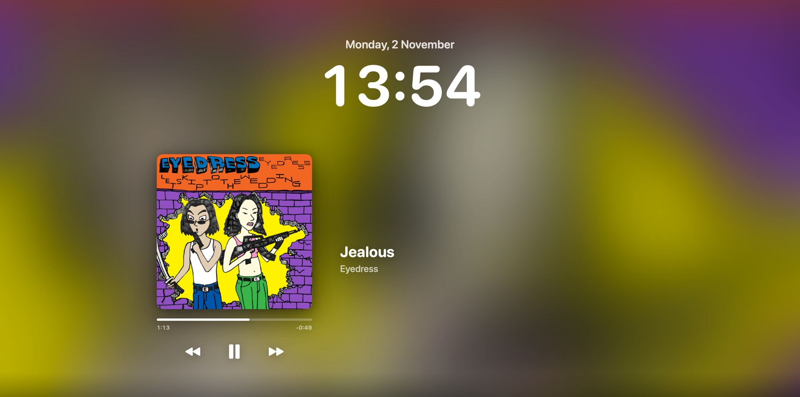

# Coverlock

A lock-screen music player for macOS. While Spotify or Apple Music is playing, Coverlock
puts the album cover across your lock screen with the track, a progress bar,
⏮ ⏯ ⏭ controls and time-synced lyrics.



## Install

On a new Mac, paste this into Terminal:

```sh
curl -fsSL https://raw.githubusercontent.com/krabduke/coverlock/main/install.sh | zsh
```

It installs **Coverlock** and **[Boring Notch](https://github.com/TheBoredTeam/boring.notch)**
(a free Dynamic Island for the notch) and opens both. Add `-s -- --coverlock-only` after `zsh`
to skip Boring Notch.

Then:

1. **Turn on login items**, or the apps won't come back after a restart: tick
   **Open at login** in Coverlock's ♪ menu, and **Launch at login** in Boring Notch's
   settings (⭐ menu).
2. **Allow the permission prompts.** Coverlock asks to control Spotify / Music. Boring
   Notch asks for Accessibility, which macOS 27 calls "Device Control and Data Access".

The prebuilt download runs on Apple Silicon Macs with macOS 14 or later. On an Intel Mac,
build it from source (below).

## Using it

Everything lives in the ♪ menu-bar icon:

| Menu item | What it does |
|---|---|
| Show on lock screen | Turns the lock-screen player on or off |
| Show lyrics | Time-synced lyrics from [LRCLIB](https://lrclib.net) |
| Background | **Album art as wallpaper** (swaps your wallpaper for the blurred cover while music plays and restores it afterwards), **Album art overlay**, or **Keep my wallpaper** |
| Preview for 10 seconds | Shows the player over your desktop without locking |
| Open at login | Starts Coverlock automatically |

Lyrics lookups send only the song title, artist, album and length to LRCLIB.

## Build from source

Needs the Xcode command line tools (`xcode-select --install`).

```sh
git clone https://github.com/krabduke/coverlock.git
cd coverlock
./build.sh --install    # builds, copies to /Applications, launches
```

`scripts/release.sh vX.Y.Z` builds the app and publishes it as a GitHub release, which
is what the installer downloads.

## How it works

- **Now playing:** Spotify and Music broadcast a notification on every play, pause and
  track change. Coverlock listens for those rather than polling, and uses AppleScript for
  the controls.
- **Drawing on the lock screen:** windows are moved into a private SkyLight space that
  sits above the lock screen. This is the technique from
  [Lakr233/SkyLightWindow](https://github.com/Lakr233/SkyLightWindow) (MIT), which Boring
  Notch also uses. It relies on private macOS API, so a macOS update can break it.

## License

MIT
